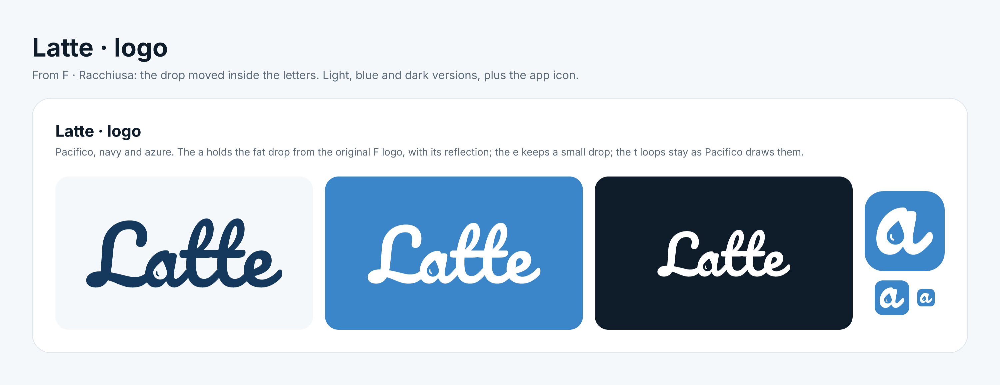

# Latte logo

Tracks erme2/Latte#63. *Latte* is Italian for milk, so the logo is about milk itself, with no coffee cup.



The word **Latte** is set in [Pacifico](https://fonts.google.com/specimen/Pacifico), with the letters converted to outlines. The hole in the **a** is a fat milk drop with a small reflection, and the **e** has a small drop. The **t** loops stay as Pacifico draws them. Pacifico is only for the logo. The app keeps Inter.

## Files

| File | Use |
| --- | --- |
| `latte-logo-light.svg` / `.png` | Navy logo on the light background (default) |
| `latte-logo-blue.svg` / `.png` | White logo on azure |
| `latte-logo-dark.svg` / `.png` | White logo on the dark background |
| `latte-icon.svg`, `latte-icon-512.png`, `-192.png`, `-32.png` | App icon and favicon: the **a** with its drop |
| `latte-logo.figcraft` | FigCraft source of the board below |
| `latte-logo-board.png` | Board: light, blue and dark, plus the icon at 120, 52 and 26 px |
| `latte-logo-options.png` | The three options we compared (Pacifico, Lobster, Modak). Pacifico was chosen. |

The SVGs include their background. The drop is cut in the background colour, so put the logo on the background it was made for. To place the logo on a different background, regenerate it with that colour.

## Colours

| Name | Hex | Used for |
| --- | --- | --- |
| Navy | `#14395C` | Letters on light |
| Azure | `#3A86C8` | Blue background, app icon |
| Light | `#F5F8FB` | Light background |
| Dark | `#0F1D2B` | Dark background |

## Regenerate

The scripts are in `design/build/logo/`. They read the fonts from the npm packages `@expo-google-fonts/pacifico` and `@expo-google-fonts/inter`, and need `fonttools`.

```bash
npm i --prefix /tmp/fonts @expo-google-fonts/pacifico @expo-google-fonts/inter
pip install fonttools
python3 design/build/logo/build_latte_counters.py /tmp/fonts/node_modules > logo.jsonl
figcraft-cli run logo.jsonl --out design/logo/wordmark/latte-logo.figcraft
figcraft-cli export design/logo/wordmark/latte-logo.figcraft -o /tmp/logo-png/ --scale 2
```

The drop positions are set by hand, in Pacifico's glyph units, in `DROPS` inside `build_latte_counters.py`.

## Still to do

The cPanel design and the app shell still use the old cup logo, `design/logo/latte-logo.svg`. Swapping in this logo is a follow-up.
