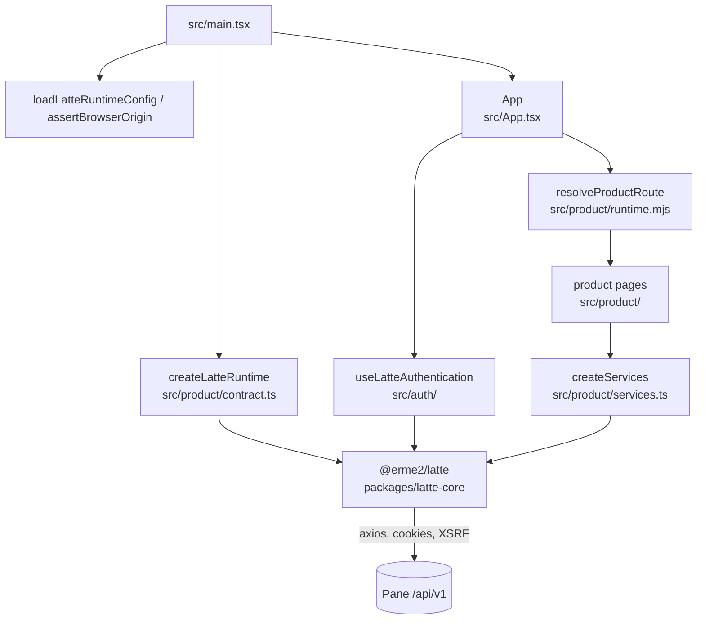
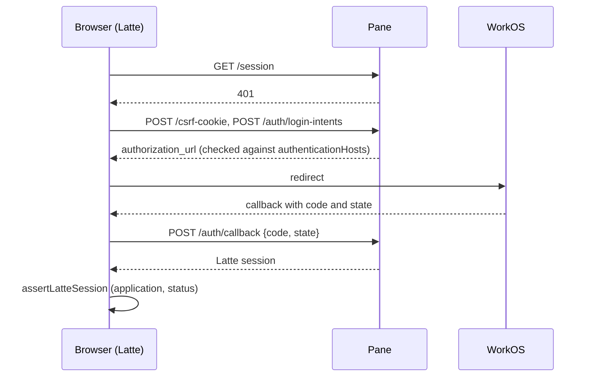

# Latte architecture

This document explains how Latte is built and where its responsibilities end. Use it to work out
where a change belongs and which contracts it must keep. For the product and security contract
shared by Pane, Latte and the product apps, see [product architecture](product-architecture.md); this document
links to it instead of repeating it. Pane's side is in
[Pane architecture](https://github.com/erme2/Pane/blob/main/docs/architecture.md) and the
[Pane API v1 contract](https://github.com/erme2/Pane/blob/main/docs/api-v1.md).

"Burro" in older tickets meant this repository before the rename. The separate Burro console and
the organization model are retired in the MVP roadmap (owner decisions of 2026-11-18): Latte is
the admin frontend over Pane's CRUD route, with the same login as the product apps.

Each statement is labelled:

- **Current:** checked against `main` when this document was written.
- **Target:** an agreed decision that future changes must keep, not built yet.
- **Open:** not decided yet. Don't infer it from the code.

## Role in the product

**Current.** Latte is a browser-only React and TypeScript application, built with Vite and served
as static files. It authenticates through Pane and uses Pane as its only data-access layer. Each
deployment is tied to one application registration in one Pane installation. There are no
organizations.

Latte is responsible for:

- loading and checking its public runtime configuration (`/latte-config.json`);
- the browser side of sign-in, invitation links, callbacks, session expiry and sign-out;
- calling Pane's `/api/v1` with cookies and the CSRF header;
- checking that the session Pane returns belongs to this deployment's application;
- routing, navigation and role-aware pages;
- showing Pane errors as safe, fixed messages;
- the screens for members and invitations.

Latte is not responsible for, and must never take on:

- authentication, OAuth state, sessions, or choosing an application (Pane does these);
- authorization. Hiding a route or button only helps usability: Pane checks every request;
- database credentials or direct database connections. Latte never receives or holds them;
- secrets of any kind. Everything in the browser bundle and in `latte-config.json` is public.

## Structure

**Current.** The repository has two parts with different distribution rules, described in the
[template and extension contract](template-contract.md):

### `@erme2/latte` (`packages/latte-core/`)

The public, headless package that derived applications upgrade to get shared fixes. It has no
routes, pages, branding or styles. It is built to `packages/latte-core/dist/` and the app imports
it only through its package name, the same boundary derived apps use.

| Module | Responsibility |
| --- | --- |
| `src/config.ts` | `parseLatteRuntimeConfig`, `loadLatteRuntimeConfig`, `assertBrowserOrigin`: strict config validation, rejecting unknown keys |
| `src/client.ts` | `createPaneClient`: the axios client (`withCredentials`, `XSRF-TOKEN` to `X-XSRF-TOKEN`, Pane access errors normalized) |
| `src/auth.ts` | `createAuthService` (session, login intent, single-flight callback, logout), `resolveInitialAuthentication`, invitation token checks, `validateAuthRedirectUrl`, sign-in failure messages |
| `src/session.ts` | `assertLatteSession` (mode, application and status), `hasUserRole`, admin-only redirects |
| `src/errors.ts` | `PaneAccessError`, `paneAccessFailure`, `paneErrorCode`, `paneErrorStatus`, `rejectPaneAccessFailure` |
| `src/versioned.ts` | `versionedItemResponse`: pairs an item document with its required `ETag` |
| `src/release.ts` | `loadLatteRelease` and labels for the deployed version badge |
| `src/types.ts` | `LatteRuntimeConfig`, `LatteSession`, resource and response shapes, `userRoles` |

### Starter application (`src/`)

What a derived application copies and owns.

| Path | Responsibility |
| --- | --- |
| `src/main.tsx` | Entry point: loads config, checks the origin, builds the runtime and renders `App`, or a configuration error page; renders `ReleaseBadge` in its own root |
| `src/App.tsx` | Shell: sign-in status screen, top bar, role-filtered navigation, route resolution, page rendering |
| `src/auth/lifecycle.mjs` | Sign-in lifecycle steps (`authenticate`, `beginSignIn`, `handlePaneFailure`, `logout`, `retryAuthentication`), written without React so they can be tested directly |
| `src/auth/useLatteAuthentication.ts` | React hook that runs the lifecycle and adds a Pane response interceptor while signed in |
| `src/product/contract.ts` | `LatteProduct`, `ProductContext`, `PlatformContext` types, `createLatteRuntime`, `defineLatteProduct` checks |
| `src/product/runtime.mjs` | Route pattern validation and matching (`validateRoutePattern`, `matchRoutePattern`, `resolveProductRoute`) |
| `src/product/manifest.tsx` | The product manifest: brand, auth hosts, default path, routes, navigation, forbidden and not-found pages |
| `src/product/services.ts` | `createServices`: product services built once from the platform context |
| `src/product/pages.tsx` | Placeholder pages: `Connection`, `Forbidden`, `NotFound` |
| `src/product/dashboard/Dashboard.tsx` | Dashboard function: count and recent-record cards drawn from the maps' `ui.dashboard` (below) |
| `src/ReleaseBadge.tsx` | "Built with Latte" link and deployed version |

### Invariants and forbidden dependencies

- `packages/latte-core` must not import from `src/`, React, or any product code.
- Product code under `src/product/` must not change or bypass package authentication, session,
  validation or Pane client internals. Add product behaviour through the manifest and
  `createServices`.
- Pane calls go through the single client from `createPaneClient`. Don't create other axios
  instances or use `fetch` against Pane.
- `latte-config.json` holds assertions only. Its application UUID is checked against Pane's
  session; it never selects anything on the server.

## Runtime, routing and state

**Current.**

- **Start-up.** `src/main.tsx` fetches `/latte-config.json` (`no-store`), validates it, and stops
  with "Application configuration error" if it is invalid or the page is served from another
  origin than `expectedOrigin`. `createLatteRuntime` then builds, once, the Pane client, the maps
  service, the auth service and the product services.
- **Routing.** There is no router library. `App` resolves `window.location.pathname` against
  `product.routes` with `resolveProductRoute` on each render. Patterns use whole-segment
  parameters (`/connections/:connectionId`); values are decoded into `context.params`. Unmatched
  paths and bad encodings render `notFoundPage`; a role mismatch renders `forbiddenPage` without
  rendering the page. Navigation is plain `<a href>` links, so moving between pages reloads the
  app. `defineLatteProduct` rejects duplicate routes, a `defaultPath` with no route, and navigation
  pointing at an undeclared route.
- **State.** No global store and no client cache. Sign-in state lives in `useLatteAuthentication`.
  Each feature keeps its own state in a hook (for example the members hook), and
  re-reads from Pane after each change instead of updating local copies. Nothing is kept in
  `localStorage` or `sessionStorage`, and invitation tokens are never stored.
- **Configuration sources.** At build time: `VITE_PANE_PROXY_*` in `.env` (host `npm run dev`
  only, checked by `vite-pane-proxy.mjs`). At run time: `/latte-config.json` for each deployment
  (`public/latte-config.json` is the local example, `docs/examples/latte-config.hostinger.json`
  the hosted one), and `/latte-release.json`, written by the deploy.
- **Local and Docker.** With `npm run dev`, Vite proxies `/pane` to an allowed local Pane target.
  With `docker compose up`, `nginx/default.conf` terminates TLS for `https://latte.localhost`,
  sends `/pane/*` to Pane's PHP-FPM (`app:9000`) on the shared `pane_laravel` network, and proxies
  everything else to Vite. The Docker files are for development only. Production is the static
  `dist/` build: Hostinger, `public/.htaccess` for the SPA fallback and caching, see
  [Hostinger hosting](hostinger-hosting.md).

## Authentication, sessions and trust boundaries

**Current.** The full sequence is in [WorkOS authentication through Pane](workos-auth.md). In
short:

- Pane owns OAuth state, identity, the session cookie and the application binding. Latte forwards `code` and `state` without reading them.
- Every redirect URL Pane returns (login and logout) must be HTTPS on a host in the manifest's
  `authenticationHosts`, checked by `validateAuthRedirectUrl`.
- The callback exchange is single-flight per `code` and `state`, so React's development effect
  replay can't use a one-time code twice. Retrying after a failed callback removes the callback
  parameters first.
- CSRF: the Pane client sends Pane's `XSRF-TOKEN` cookie back as `X-XSRF-TOKEN` on mutating
  requests.
- While signed in, `useLatteAuthentication` adds an interceptor: a `401` session error sends the
  user to sign in again, and a Pane access failure (for example `application_not_allowed`) returns the app to its status screen with
  a fixed message.
- Admin-only consoles (`adminOnly` in config) send non-administrators to `productAppUrl`, and with
  `loginUrl` send signed-out visitors to that page. Pane still enforces admin-only actions; see
  [admin-only console mode](template-contract.md#admin-only-console-mode).
- Trust boundary: the browser is untrusted. Pane's responses are trusted for identity and
  authorization; config values are only expectations that the session must match. Latte shows
  only messages chosen from Pane's `error.code`, never server details, target emails or
  token metadata.

## Data and user flows

### Members and invitations (Current)

`/members` (administrators only, shown while the install's `members` function is on) invites an
administrator or a user and lists both kinds of invitation through `createInvitationsService`, which
calls Pane's installation routes (`/installation/pane-admin-invitations` and
`/installation/user-invitations`). A new invitation shows its delivery URL once, with a copy button.
Pane sends an invitation's `ETag` only when it is created, so only invitations created in the open page
can be revoked (`If-Match`). Failures are shown as fixed messages (`operation_conflict`,
`validation_failed`, `rate_limited`, or a generic one).

Not built yet, because Pane has no route for them: a members list with roles, and revoking an
invitation read from a list (it needs an `ETag` in the list or a read route).

### Records (Implemented, Latte#81)

`/records/:source/:table` is the generic list and edit screen, tagged with the `records` function (off in the
maps means no route). The menu entries come from the maps (`buildMapsShell`); the screen reads the table's map
(`GET /api/v1/maps/{source}/{table}`) and `buildRecordView` turns it into columns, default sort and form fields:

- Columns: `ui.list.columns` (unknown names are dropped), else the first six visible fields. `ui.list.default_sort`
  sets the first sort (`-name` for descending); a header is a sort button when the field is `sortable`.
- Form: every visible, non-computed field, with an input chosen from the field `type` (and `format: email`,
  `ui.widget: textarea`): text, email, number, checkbox, textarea, date, password, and JSON for `array` and `json`.
  `ui.label` and `ui.help` give the label and help text. The primary key is read-only on edit and left out on create.
- Rows go through Pane's `/crud/{table}` route (`createCrudService`: `list`, `get`, `create`, `update`, `remove`;
  the table name is the subject, bodies are the plain field object). A failed validation (`400`,
  `data.errors: [{field_name, message}]`) is shown next to the field; any other failure shows a fixed message.
  Deleting asks for a confirmation in the row first. Pane decides who may read and write.
- Table creation and field changes are not here: migrations and Pane's maps are the source of truth. A table added
  through them appears in the menu and works with no Latte code change.

### Dashboard (Implemented, Latte#73)

The dashboard is a switchable function (`dashboard`, with `members`; a function that is off has no route
and no menu entry). Its cards come from a table's `ui.dashboard` in the maps, a Latte convention because
Pane keeps `ui` open: `{count: boolean, recent: 1-10, sort: field, position: number}`. A card shows the
row total (`pagination.total`) and/or the newest `recent` rows (by `sort`, descending; columns from
`ui.list.columns`, first three). System tables never get a card, and a malformed config gives none.
Rows are read with `createCrudService(...).list(table)`, a read-only `GET /crud/{subject}` that uses
the table name as the subject and the route's envelope `{status, data, pagination: {page, limit, total}}`.
Pane decides who may read; a card Pane refuses shows a fixed error message. Create, edit and delete are on the records screen (Latte#81).

### Shell and views drawn from the maps

The shell is current. Latte builds its menu, enabled functions and branding from Pane's maps
bootstrap, `GET /api/v1/maps` (Pane#154, closed), through `src/shell/useMapsShell.ts`. Latte#81 draws the list and edit views from each table map's `ui` part
(`GET /api/v1/maps/{source}/{table}`). Target, not implemented: Latte#71 adds a maps editor for fields,
validation and views. In the MVP Latte edits maps and data, never tables: migrations are the source of truth.

Requests keep the same shape as today: the page calls a service, the service calls Pane through
the shared client, Pane decides, and Latte shows the result or a fixed error message. Latte never
sends raw SQL, client-chosen column names outside the map, or row ownership.

### Loading, errors and safety (Current)

- Screens show a loading line while a request runs and a fixed message on failure; the sign-in
  status panel uses `aria-live="polite"`.
- Pane access failures are turned into `PaneAccessError` by the client and shown with
  `paneAccessFailure`.
- Destructive membership actions are limited in the UI: the last active administrator can't be
  demoted or suspended, and only pending invitations can be revoked. Pane enforces the same rules.
- Row delete asks for a confirmation in the row; there is no undo. **Open:** suspend and revoke still have no
  confirmation step.

## Current and target: known differences

| Area | Current | Target |
| --- | --- | --- |
| Shell, menu and pages | Built from Pane maps (Latte#69, on `main`) | Unchanged |
| Record screens | Generic list, create, edit and delete through `/crud` (Latte#81) | Unchanged |
| Menu and views | Menu and views drawn from the maps | Unchanged |
| Maps editor | None | Edits fields, validation and views (Latte#71) |
| Connections | Placeholder `/connections/:connectionId` route and page | **Open**: no managed connections in the MVP; likely removed |
| Navigation | Full page loads through `<a href>` | **Open**: no decision on client-side navigation |
| Caching | None; re-read after every write | **Open** |

Update this document when any of these land.

## Extension points

- **Manifest** (`src/product/manifest.tsx`): brand, authentication hosts, routes, navigation,
  forbidden and not-found pages.
- **Services** (`createServices` in `src/product/services.ts`): product API calls built on the
  platform context (`pane`, `config`, `maps`).
- **Feature folders**: one folder per feature under `src/product/`, with the view, a state hook and presentation helpers.
- **Package**: changes that every derived app needs (Pane contract, authentication, errors) go into
  `packages/latte-core` and ship in a new `@erme2/latte` version.

## Tests

**Current.** Tests are plain Node scripts in `scripts/*.test.mjs`, run by `npm test` after building
the package; CI (`.github/workflows/pr-tests.yml`) runs `npm test`, `npm run lint` and
`npm run build`.

- Package behaviour (config, auth, sessions, errors, invitations, maps): tests against the built
  package, such as `scripts/auth-service.test.mjs`.
- Shell lifecycle: `scripts/auth-lifecycle.test.mjs` runs `src/auth/lifecycle.mjs` with a fake
  browser.
- Routing and manifest rules: `scripts/product-extension.test.mjs`.
- Pane contract and documentation guards: `scripts/auth-contract.test.mjs`,
  `scripts/template-contract.test.mjs`, `scripts/product-architecture.test.mjs`,
  `scripts/architecture-doc.test.mjs`.
- Infrastructure: proxy, Nginx, Docker, Hostinger and release scripts each have their own test.

There are no React component tests or browser end-to-end tests yet. Keep logic in plain modules
(as `lifecycle.mjs` and `runtime.mjs`) so it can be tested this way. **Open:** whether to add a
component test runner when the maps-driven screens arrive.

## Before making changes

- [ ] Is it product behaviour (manifest, services, `src/product/`) or a shared Pane contract
      (`packages/latte-core`)? Put it in one place only.
- [ ] Does every Pane path go through the shared client?
- [ ] Is nothing secret added to the bundle, `latte-config.json` or storage?
- [ ] Does it rely on Pane for authorization, using roles only to hide UI?
- [ ] Are writes sent with the `ETag` from a fresh read, and are conflicts shown?
- [ ] Are Pane errors shown only through fixed messages chosen by `error.code`?
- [ ] Is the logic in a plain module with a `scripts/*.test.mjs` test, added to `npm test`?
- [ ] Do `npm test`, `npm run lint` and `npm run build` pass?
- [ ] Does this document, `template-contract.md` or `workos-auth.md` need updating?
